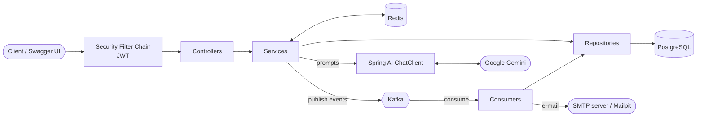

# intelliCar

> An AI-powered used car marketplace backend built with Spring Boot, Spring AI (Google Gemini), PostgreSQL, Redis and Apache Kafka.

[](https://github.com/<your-username>/intelliCar/actions/workflows/ci.yml)


intelliCar is the backend of a car gallery platform where sellers publish vehicle listings and buyers browse, filter and make price offers. On top of the marketplace, an AI assistant helps both sides:

- **Buyers** tell the assistant their budget and get a ranked list of the best matching cars from the real listings.
- **Sellers** describe the car they own and get a suggested price range, based on similar listings on the platform.

Behind the API, domain events (new offers, listing views, status changes) are processed asynchronously through Kafka, sellers and buyers are notified by e-mail, frequently read data is cached in Redis, and the AI endpoints are protected by per-user rate limits. The whole system is covered by integration tests that run against real PostgreSQL, Redis and Kafka containers, and every change is verified by a CI pipeline.

This project was developed as a graduation project.

---

## Table of Contents

- [Features](#features)
- [Tech Stack](#tech-stack)
- [Architecture](#architecture)
- [AI Features](#ai-features)
- [Event-Driven Design with Kafka](#event-driven-design-with-kafka)
- [E-mail Notifications](#e-mail-notifications)
- [AI Rate Limiting](#ai-rate-limiting)
- [Domain Model](#domain-model)
- [API Overview](#api-overview)
- [Getting Started](#getting-started)
- [Configuration](#configuration)
- [Testing and CI](#testing-and-ci)
- [Troubleshooting](#troubleshooting)
- [Project Structure](#project-structure)
- [Design Decisions](#design-decisions)
- [Future Work](#future-work)

---

## Features

### Marketplace

- **Authentication and authorization.** Registration, login, short-lived JWT access tokens, refresh tokens stored server-side, logout that revokes the session, and role-based users (`BUYER`, `SELLER`, `ADMIN`).
- **Listings.** Sellers create, update and soft-delete car listings with multiple images and a primary image.
- **Search and filtering.** Dynamic, paginated filtering by brand, model, city, price range, year range, fuel type and transmission.
- **Offers.** Buyers make offers on active listings and sellers accept or reject them. Business rules prevent offers on your own car, on inactive listings, and duplicate pending offers.

### AI assistant

- **Budget assistant.** Ranks the best cars for a given budget and preferences, with a score, a reason, pros and cons for each car. See [AI Features](#ai-features).
- **Price estimation.** Suggests a selling price range for the user's own car. The price is calculated from listings of the same model and year, compared by mileage, and then adjusted by the AI for damage record, replaced parts and paint.
- **Guardrails.** The model only sees real listings, its answers are validated against them, and a statistical fallback covers model outages. See [Safety and reliability](#safety-and-reliability-of-the-ai-layer).
- **Fair use.** Per-user rate limits protect the model quota. See [AI Rate Limiting](#ai-rate-limiting).

### Asynchronous processing and notifications

- **Kafka event pipeline.** Listing view counting, automatic expiry of pending offers when a car is sold or deactivated, and offer notifications run outside the request path. See [Event-Driven Design with Kafka](#event-driven-design-with-kafka).
- **E-mail notifications.** The seller is e-mailed when a new offer arrives and the buyer when the offer is accepted or rejected. See [E-mail Notifications](#e-mail-notifications).

### Performance and reliability

- **Redis caching.** Car detail responses are cached in Redis and evicted on update or delete.
- **Resilient by design.** A slow or unavailable Kafka broker, mail server or AI provider does not break the core marketplace flows.

### Engineering quality

- **Automated tests.** Unit tests plus integration tests that exercise the real stack (PostgreSQL, Redis, Kafka) with Testcontainers. See [Testing and CI](#testing-and-ci).
- **Continuous integration.** A GitHub Actions pipeline builds, tests and packages every push and pull request.
- **API documentation.** Interactive Swagger UI generated from the code.
- **Containerized setup.** PostgreSQL, Redis, Kafka, a local development inbox (Mailpit) and the backend start with a single Docker Compose command.

---

## Tech Stack

| Area | Technology | Purpose |
|---|---|---|
| Language | Java 21 | Main language |
| Framework | Spring Boot 4.1.1 | Application framework and auto-configuration |
| AI | Spring AI 2.0, Google Gemini | `ChatClient`, structured output, AI features |
| Web | Spring Web MVC | REST controllers |
| Persistence | Spring Data JPA, Hibernate | ORM, repositories, `Specification`-based dynamic queries |
| Database | PostgreSQL 15 | Primary relational data store |
| Cache | Redis 7, Spring Cache | Caching of listing details |
| Messaging | Apache Kafka (KRaft mode), Spring for Apache Kafka | Asynchronous, event-driven processing |
| E-mail | Spring Boot Mail (`JavaMailSender`), Mailpit for development | Offer notifications |
| Security | Spring Security, JJWT 0.12.5, BCrypt | Stateless JWT authentication, password hashing |
| Validation | Jakarta Bean Validation | Request validation |
| Mapping | MapStruct 1.5.5 | Entity to DTO mapping |
| Boilerplate | Lombok | Getters, constructors, logging |
| API docs | springdoc-openapi 3.1.1 | OpenAPI 3 spec and Swagger UI |
| Testing | JUnit 5, Mockito, AssertJ, Awaitility, Testcontainers | Unit and integration tests against real infrastructure |
| Build | Maven (wrapper included) | Build and dependency management |
| Containers | Docker, Docker Compose | Local environment and deployment image |
| CI | GitHub Actions | Build, test and Docker image check on every push and pull request |

---

## Architecture

The application follows a classic layered architecture. Controllers only handle HTTP concerns, services contain business rules and transactions, repositories talk to the database. Request and response objects are immutable Java records.



---

## AI Features

Both AI features follow the same principle: **the database provides the facts, the model provides the judgment.** The application first selects real listings from PostgreSQL, then asks Gemini to analyze only that data. The model never decides which cars exist and never invents prices.

### 1. Budget-based car recommendation

`POST /intelliCar/api/v1/ai/recommend`

The user enters a budget and, optionally, free-text preferences and filters. The assistant returns the best matching cars, ranked.

How it works:

1. Active listings within the budget are loaded (up to 30, newest and lowest mileage first). Optional filters: fuel type, transmission, city. The user's own listings are excluded.
2. Gemini ranks the listings and writes a score (0 to 100), a short reason, pros and cons for each pick.
3. The response is validated: ids that are not in the candidate list are dropped, duplicates are removed, and price, year and mileage are always taken from the database, never from the model.
4. If no listing fits, the model is not called at all and a helpful message is returned.

Example request:

```json
{
  "budget": 1200000,
  "preferences": "family car, low fuel consumption",
  "fuelType": "DIESEL",
  "limit": 3
}
```

Only `budget` is required. `limit` accepts 1 to 10 (default 5).

Example response (shortened):

```json
{
  "budget": 1200000,
  "candidatesAnalyzed": 14,
  "summary": "...",
  "recommendations": [
    {
      "rank": 1,
      "score": 88,
      "carId": "3f6c...",
      "brand": "Skoda",
      "model": "Octavia",
      "year": 2020,
      "mileage": 72000,
      "price": 1150000,
      "reason": "...",
      "pros": ["..."],
      "cons": ["..."]
    }
  ]
}
```

### 2. Selling price estimation

`POST /intelliCar/api/v1/ai/price-estimate`

The user describes the car they want to sell, including its condition. The assistant compares it with real listings and suggests a price range.

**Example.** A user enters a *BMW M5 CS, 2020, 134,000 km*. The platform has three listings of the same model and year: 100,000 km for 3,000,000 TL, 150,000 km for 2,700,000 TL and 300,000 km for 2,200,000 TL. The base price is calculated in code from the two listings closest in mileage, so the result lies between them: 100,000 km is more expensive, 150,000 km is cheaper, and 134,000 km is priced proportionally in between (2,796,000 TL). The 300,000 km listing does not distort it.

How it works:

1. Active and sold listings of the same brand are loaded (the user's own listings are excluded).
2. **Base price (plain Java, no AI).** The analyzer looks for listings with the same model and the same model year:
   - **2 or more:** the price is interpolated by mileage between the two listings closest in mileage. If the car has less or more mileage than all listings, the price is extended with the slope of the nearest listings and capped at 15% above or below the closest listing. Method: `MILEAGE_BASED`.
   - **1:** that listing's price is used. Method: `SINGLE_COMPARABLE`.
   - **None:** the most similar listings of the brand (scored by model, year, mileage, fuel type, transmission and city) are used and the median price is the base. Method: `SIMILAR_LISTINGS`.

   Model names must match exactly (ignoring case and extra spaces), so an *M5* listing is not counted as an *M5 CS*.
3. **Condition analysis (AI).** Gemini reads the description of the user's car and the descriptions of the comparable listings. It looks for the damage record, replaced parts and painted parts, compares the car's condition with the comparables and adjusts the base price. A clean car (no damage record, no paint, no replaced parts) is priced slightly higher, a car with a damage record or painted or replaced parts is priced lower. It also reports the effect as `conditionImpact`: `POSITIVE`, `NEUTRAL`, `NEGATIVE` or `UNKNOWN` (no condition information in the description).
4. **Validation.** The suggestion is checked in code before it is returned. With mileage-based pricing, the model may move the price at most 35% down or 10% up, and the direction must match the condition analysis: a worse condition cannot be priced above the base price, a better condition cannot be priced below it, and without condition information the price must stay within 10% of the base price. If the answer is inconsistent, or Gemini is unavailable, the base price and its statistical range are returned (`aiAssisted: false`) and the response says that the condition was not reflected.
5. If there is no listing of that brand, the API responds with `400`, because there is nothing to compare against.

The `confidence` field (`LOW`, `MEDIUM`, `HIGH`) is calculated in code and is never asked from the model:

| Situation | Confidence |
|---|---|
| 4 or more listings of the same model and year | `HIGH` |
| 2 or 3 listings of the same model and year | `MEDIUM` |
| 1 listing of the same model and year | `LOW` |
| No listing of the same model and year, 3 or more of the same model | `MEDIUM` |
| Otherwise | `LOW` |

If the car's mileage is outside the mileage range of the listings, the confidence drops one level. Prices are rounded to the nearest 1,000.

Example request:

```json
{
  "brand": "BMW",
  "model": "M5 CS",
  "year": 2020,
  "mileage": 134000,
  "fuelType": "GASOLINE",
  "transmission": "AUTOMATIC",
  "city": "Istanbul",
  "description": "Hasar kaydı yok, boyasız, değişen parça yok. Düzenli yetkili servis bakımlı."
}
```

Example response (shortened):

```json
{
  "minPrice": 2790000,
  "suggestedPrice": 2900000,
  "maxPrice": 3010000,
  "currency": "TRY",
  "confidence": "MEDIUM",
  "aiAssisted": true,
  "method": "MILEAGE_BASED",
  "mileageBasedPrice": 2796000,
  "condition": {
    "impact": "POSITIVE",
    "summary": "Hasar kaydı, boya ve değişen parça yok, yetkili servis bakımlı."
  },
  "explanation": "...",
  "factors": ["..."],
  "market": { "comparablesCount": 3, "sameModelCount": 3, "exactMatchCount": 3, "min": 2200000, "median": 2700000, "max": 3000000 },
  "comparables": [{ "mileage": 100000, "price": 3000000, "exactMatch": true }],
  "disclaimer": "..."
}
```

`mileageBasedPrice` is the price from listings and mileage alone. `suggestedPrice` differs from it only by the effect of the car's condition.

**Tip for listings.** The description of a listing is read by the price assistant. Sellers should write the damage record (and amount), replaced parts and painted parts in the description, for example *"Tramer kaydı yok, boyasız, değişensiz"* or *"Sol ön çamurluk boyalı, 45.000 TL hasar kaydı"*. The more accurate the descriptions, the better the comparison.

> The estimate is based on asking prices of listings on this platform and on what the descriptions say. Actual sale prices and the real condition of a car (expert inspection) can differ.

### Safety and reliability of the AI layer

- **No hallucinated cars or prices.** Model output is validated against the data that was sent to it.
- **Structured output.** Spring AI maps the model response to Java records, so malformed answers fail early.
- **Prompt injection resistance.** User preferences and listing descriptions are sent as data, and the prompt tells the model not to follow instructions inside them.
- **Authenticated only.** Every AI call costs quota, so the endpoints require a valid JWT.
- **Rate limited.** Each user is limited per minute and per day, and beyond the limit the API returns `429`. See [AI Rate Limiting](#ai-rate-limiting).
- **Graceful failure.** If Gemini is unavailable, the recommendation endpoint returns `503`, and the price endpoint falls back to the statistical range.
- **Low temperature** (0.2) and a short retry policy keep answers consistent and failures fast.

---

## Event-Driven Design with Kafka

Slow or secondary work is moved out of the request path and handled asynchronously.

| Topic | Published by | Consumer (group) | What it does |
|---|---|---|---|
| `offer-events` | Offer service when an offer is created or answered | `OfferNotificationConsumer` (`notification-group`) | E-mails the seller about a new offer and the buyer about the decision. |
| `car-view-events` | Car controller on every listing view | `CarViewConsumer` (`view-counter-group`) | Increments the view counter with an atomic SQL update. |
| `car-status-events` | Car service when the status changes or a listing is deleted | `CarStatusConsumer` (`offer-expiry-group`) | Sets all `PENDING` offers of a car to `EXPIRED` when it becomes `SOLD` or `INACTIVE`. |

Key points:

- **Publish after commit.** Events are sent only after the database transaction commits, so a rolled-back request never produces a phantom event.
- **Resilient producer.** If Kafka is unreachable, the request still succeeds and the failure is logged (`max.block.ms` is limited to 3 seconds).
- **Retries.** If a consumer fails (for example the mail server is briefly down), the record is retried 3 times, 5 seconds apart, then logged and skipped.
- **No e-mail addresses in events.** Events carry user ids only. The consumer reads the address from the database at send time, so personal data does not sit in Kafka.
- **Ordering per entity.** The entity id is used as the message key, so all events of one offer or car land in the same partition and stay ordered.
- **View counting outside the cache.** The detail endpoint is cached, so a cache hit never reaches the service method. The view event is therefore published from the controller, which runs on every request.
- **JSON events** are defined as Java records in the `event` package.

---

## E-mail Notifications

Offers are time-sensitive, so both sides are notified without having to check the platform.

| Event | Recipient | Subject example |
|---|---|---|
| A buyer makes an offer | The seller of the car | `Yeni teklif: Toyota Corolla` |
| The seller accepts the offer | The buyer | `Teklifiniz kabul edildi: Toyota Corolla` |
| The seller rejects the offer | The buyer | `Teklifiniz reddedildi: Toyota Corolla` |

E-mails are plain text, written in Turkish, and contain the car, the offered price (for example `1.050.000 TL`) and what to do next.

How it works:

1. The offer service publishes an event to Kafka after the database transaction commits.
2. `OfferNotificationConsumer` receives it and calls `EmailNotificationService`.
3. The service loads the recipient from the database, renders the text with `EmailTemplates` and sends it through Spring's `JavaMailSender`.

Design notes:

- **Never blocks the request.** The offer API responds as soon as the offer is saved. If the mail server is slow or down, the user does not notice, and the send is retried 3 times, 5 seconds apart.
- **Privacy.** Events carry user ids, not e-mail addresses, and addresses are never written to logs.
- **Header injection protection.** Values that end up in the subject (for example the car title) are reduced to a single line and truncated, so user input cannot add mail headers.
- **Development without risk.** By default, mails go to [Mailpit](https://mailpit.axllent.org/), a local inbox that catches everything and delivers nothing to real people. Open <http://localhost:8025> to read them.
- **Production ready.** Any SMTP server works. Set the `MAIL_*` variables (see [Configuration](#configuration)), for example with a Gmail app password.

---

## AI Rate Limiting

Every AI request costs model quota and money, so both AI endpoints are limited **per user**.

| Limit | Default | Property |
|---|---|---|
| Requests per minute | 5 | `intellicar.ai.rate-limit.per-minute` |
| Requests per 24 hours | 50 | `intellicar.ai.rate-limit.per-day` |

When a limit is exceeded, the API responds with `429 Too Many Requests` and a `Retry-After` header that tells the client how many seconds to wait.

How it works:

- A Spring MVC interceptor protects `/intelliCar/api/v1/ai/**`. The authenticated user is identified from the JWT.
- Counters are fixed time windows stored in Redis (`INCR` plus `EXPIRE`), so the limit holds across multiple application instances and survives restarts.
- Both AI endpoints share one quota, because both spend the same model quota.
- A request rejected by the per-minute limit does not use up the daily quota.
- If Redis is unreachable, requests are allowed instead of blocked (fail-open), and a warning is logged. Losing the limiter should not take the AI features offline.
- Requests are counted before the body is validated, so invalid requests also count.
- Setting a limit to `0` disables that window, and `intellicar.ai.rate-limit.enabled=false` turns the feature off.

---

## Domain Model

| Entity | Description | Key fields |
|---|---|---|
| `User` | Registered account, implements Spring Security `UserDetails` | email, passwordHash, firstName, lastName, phone, role |
| `Car` | A vehicle listing | brand, model, year, mileage, price, fuelType, transmission, city, description, viewCount, status, seller |
| `CarImage` | Image of a listing | imageUrl, isPrimary, car |
| `Offer` | A buyer's price offer for a car | offeredPrice, note, status, car, buyer |
| `RefreshToken` | Server-side refresh token, one per user | token, expiryDate, revoked, user |

Enumerations:

- `UserRole`: `BUYER`, `SELLER`, `ADMIN`
- `CarStatus`: `ACTIVE`, `PENDING_REVIEW`, `SOLD`, `INACTIVE`
- `OfferStatus`: `PENDING`, `ACCEPTED`, `REJECTED`, `EXPIRED`
- `FuelType`: `GASOLINE`, `DIESEL`, `HYBRID`, `ELECTRIC`
- `Transmission`: `MANUAL`, `AUTOMATIC`

---

## API Overview

Base path: `/intelliCar/api/v1`. Full interactive documentation is available in Swagger UI once the app is running.

Protected endpoints require the header `Authorization: Bearer <access_token>`.

### Auth

| Method | Path | Auth | Description |
|---|---|---|---|
| POST | `/auth/register` | Public | Create an account and receive tokens |
| POST | `/auth/login` | Public | Log in and receive tokens |
| POST | `/auth/refresh-token` | Public | Exchange a refresh token for a new token pair |
| POST | `/auth/logout` | Required | Revoke the user's refresh token |

### Users

| Method | Path | Auth | Description |
|---|---|---|---|
| GET | `/users/me` | Required | Current user's profile |
| GET | `/users/{id}` | Required | Profile of a user |

### Cars

| Method | Path | Auth | Description |
|---|---|---|---|
| POST | `/car` | Required | Create a listing |
| GET | `/car` | Public | List active cars (filter and paginate) |
| GET | `/car/{id}` | Public | Listing details |
| GET | `/car/my-cars` | Required | Current user's listings |
| PUT | `/car/{id}` | Owner | Update price, mileage, description, status |
| DELETE | `/car/{id}` | Owner | Soft delete (status becomes `INACTIVE`) |

Filter parameters for `GET /car` (all optional): `brand`, `model`, `city`, `minPrice`, `maxPrice`, `minYear`, `maxYear`, `fuelType`, `transmission`, plus standard `page`, `size`, `sort`.

```
GET /intelliCar/api/v1/car?brand=bmw&city=ankara&maxPrice=1500000&fuelType=DIESEL&page=0&size=10&sort=price,asc
```

### Car images

| Method | Path | Auth | Description |
|---|---|---|---|
| POST | `/carImage/{carId}` | Owner | Add images to a listing |
| PATCH | `/carImage/{carId}/images/{imageId}/primary` | Owner | Set the primary image |
| DELETE | `/carImage/{imageId}` | Owner | Delete an image |

### Offers

| Method | Path | Auth | Description |
|---|---|---|---|
| POST | `/offer` | Required | Make an offer on an active car |
| PATCH | `/offer/{id}/respond?newStatus=ACCEPTED\|REJECTED` | Car owner | Accept or reject an offer |
| GET | `/offer/cars/{carId}` | Car owner | Offers received for a car |
| GET | `/offer/my-offers` | Required | Offers made by the current user |

### AI

| Method | Path | Auth | Description |
|---|---|---|---|
| POST | `/ai/recommend` | Required | Best cars for a budget and preferences |
| POST | `/ai/price-estimate` | Required | Suggested selling price range for your car |

Both AI endpoints are limited per user. When the limit is exceeded they return `429` with a `Retry-After` header (seconds).

---

## Getting Started

### Prerequisites

- JDK 21
- Docker and Docker Compose
- A Google Gemini API key (free to create at [Google AI Studio](https://aistudio.google.com/apikey))
- (Optional) Maven, the included `./mvnw` wrapper is enough

### 1. Clone the repository

```bash
git clone https://github.com/efeerturk7/intelliCar.git
cd intelliCar
```

### 2. Create your environment file

```bash
cp .env.example .env
```

Open `.env` and set your own values (see [Configuration](#configuration)). Generate a strong JWT secret with:

```bash
openssl rand -hex 32
```

### 3. Run

**Option A: everything in Docker**

```bash
docker compose up -d --build
```

**Option B: infrastructure in Docker, application from your IDE or terminal**

```bash
docker compose up -d postgres redis kafka mailpit
./mvnw spring-boot:run
```

The application must be started from the project root so that it can read the `.env` file. Do not use both options at the same time, both want port 8080.

### 4. Open the API docs

- Swagger UI: <http://localhost:8080/swagger-ui.html>
- OpenAPI JSON: <http://localhost:8080/v3/api-docs>

In Swagger UI, call `/auth/register` or `/auth/login`, copy the `accessToken`, click **Authorize** and paste it to call protected endpoints.

### 5. Try the AI features

The AI endpoints work on existing listings, and your own listings are excluded from the results. So create at least two users: one adds a few listings (`POST /car`), the other calls `/ai/recommend` or `/ai/price-estimate`. The more listings of the same brand exist, the better the price estimate.

### 6. See the e-mail notifications

By default e-mails are sent to Mailpit, a development inbox that catches every message and delivers nothing to real people. Open <http://localhost:8025>, then let one user create an offer on another user's listing (the seller gets a mail) and let the seller accept or reject it (the buyer gets a mail).

### Useful commands

```bash
# Stop everything
docker compose down

# Stop and delete all data (database, Redis, Kafka)
docker compose down -v

# Watch Kafka messages
docker exec -it intellicar-kafka /opt/kafka/bin/kafka-console-consumer.sh \
  --bootstrap-server localhost:9092 --topic offer-events --from-beginning

# Run all tests (needs a running Docker daemon, the tests start their own containers)
./mvnw verify
```

---

## Configuration

Secrets are never stored in the repository. They are read from a local `.env` file (ignored by git). A template is provided in `.env.example`.

| Variable | Description | Example |
|---|---|---|
| `POSTGRES_DB` | Database name | `intellicar_db` |
| `POSTGRES_USER` | Database user | `postgres` |
| `POSTGRES_PASSWORD` | Database password | use a strong value |
| `JWT_SECRET` | HMAC signing key for JWTs, at least 32 characters | output of `openssl rand -hex 32` |
| `GEMINI_API_KEY` | Google Gemini API key | from Google AI Studio |
| `GEMINI_MODEL` | (Optional) Gemini model name | default `gemini-3.8-flash` |
| `MAIL_HOST` / `MAIL_PORT` | (Optional) SMTP server | default Mailpit (`mailpit:1025` in Docker, `localhost:1025` otherwise) |
| `MAIL_USERNAME` / `MAIL_PASSWORD` | (Optional) SMTP credentials | Gmail app password |
| `MAIL_SMTP_AUTH` / `MAIL_STARTTLS` | (Optional) Enable authentication and STARTTLS | `true` for Gmail |
| `MAIL_FROM` | (Optional) Sender address | default `no-reply@intellicar.local` |

#### Sending real e-mails

Create an app password for your Google account (<https://myaccount.google.com/apppasswords>) and add this to `.env`:

```
MAIL_HOST=smtp.gmail.com
MAIL_PORT=587
MAIL_USERNAME=you@gmail.com
MAIL_PASSWORD=your_app_password
MAIL_SMTP_AUTH=true
MAIL_STARTTLS=true
MAIL_FROM=you@gmail.com
```

Mails then go to the addresses users registered with.

The application refuses to start if `JWT_SECRET` or `GEMINI_API_KEY` is missing, so a misconfiguration is noticed immediately.

Other settings live in `src/main/resources/application.properties`:

| Property | Default | Description |
|---|---|---|
| `intellicar.security.jwt.access-expiration` | `900000` (15 min) | Access token lifetime in ms |
| `intellicar.security.jwt.refresh-expiration` | `604800000` (7 days) | Refresh token lifetime in ms |
| `spring.ai.google.genai.chat.temperature` | `0.2` | Lower values give more consistent answers |
| `spring.kafka.bootstrap-servers` | `localhost:9092` | Kafka address (`kafka:29092` inside Docker) |
| `spring.data.redis.host` / `port` | `localhost` / `6379` | Redis address |
| `intellicar.ai.rate-limit.per-minute` | `5` | AI requests per user per minute (`0` disables this limit) |
| `intellicar.ai.rate-limit.per-day` | `50` | AI requests per user per 24 hours (`0` disables this limit) |
| `intellicar.ai.rate-limit.enabled` | `true` | Turns AI rate limiting on or off |
| `intellicar.notification.email.enabled` | `true` | Turns e-mail notifications on or off |

When the backend runs inside Docker Compose, connection settings are overridden through environment variables in `docker-compose.yaml`.

---

## Testing and CI

### Tests

The tests need **Docker** but nothing else: they start their own PostgreSQL, Redis and Kafka containers with [Testcontainers](https://testcontainers.com/), so no `.env` file and no running Compose stack is required. Your development data is never touched.

```bash
./mvnw verify
```

| Test class | Type | What it covers |
|---|---|---|
| `AiRateLimiterTest`, `EmailTemplatesTest` | Unit (no Docker) | Rate limit windows and e-mail texts, including header injection protection |
| `PriceMarketAnalyzerTest` | Unit (no Docker) | Mileage-based pricing (the BMW M5 CS example), exact-match rules, confidence levels, validation of the AI suggestion against the condition analysis |
| `AuthIntegrationTest` | Integration | Register, login, refresh token, logout, protected endpoints |
| `CarIntegrationTest` | Integration | Listing CRUD, filtering, ownership rules, Redis-cached detail, view counting through Kafka |
| `OfferFlowIntegrationTest` | Integration | Offer rules, accept and reject, e-mails sent through Kafka, offers expiring when a car is sold |
| `AiRateLimitIntegrationTest` | Integration | `429` and `Retry-After`, per-user quota, shared quota of both AI endpoints, counter in Redis |
| `IntelliCarApplicationTests` | Integration | The application starts with real infrastructure |

How the integration tests work:

- The three containers start once and are shared by all test classes, and all classes share one Spring context. Each test creates its own random users and listings, so tests do not depend on each other.
- Gemini is never called: the two AI services are replaced with mocks. E-mails are not sent: `JavaMailSender` is a mock and the tests wait for the mail that the Kafka consumer sends.
- Asynchronous steps (Kafka consumers) are awaited with Awaitility instead of fixed sleeps.
- Test settings live in `src/test/resources/application-test.properties` (test profile).

### Continuous integration

`.github/workflows/ci.yml` runs on every push to `main` and on every pull request:

1. **Build and test:** Java 21, Maven cache, `./mvnw verify` (GitHub's Ubuntu runners include Docker, so Testcontainers works out of the box). Test reports are uploaded when a run fails.
2. **Build Docker image:** builds the `Dockerfile` to make sure the image can be built. Nothing is pushed anywhere.

No secrets are needed in the repository settings.

---

## Troubleshooting

- **The app cannot connect to PostgreSQL or fails with a Hibernate dialect error.** The database is not reachable. Check `docker compose ps`. PostgreSQL only applies `POSTGRES_PASSWORD` when its volume is first created, so after changing the password in `.env` run `docker compose down -v` and start again (this deletes the data).
- **Gemini returns "model not found" (404).** Model names are retired over time. Pick a current model in Google AI Studio and set `GEMINI_MODEL` in `.env`.
- **Tests fail with "Could not find a valid Docker environment".** Start Docker Desktop (or the Docker daemon) and run the tests again.
- **The app does not start and mentions a missing placeholder.** `JWT_SECRET` or `GEMINI_API_KEY` is not defined in `.env`, or the app was not started from the project root.
- **AI endpoints return 429.** The per-user rate limit was reached. Wait for the number of seconds in the `Retry-After` header or raise the limits in `application.properties`.
- **No e-mails arrive.** Check that Mailpit is running (`docker compose ps`) and open <http://localhost:8025>. For a real SMTP server check the `MAIL_*` values in `.env`. Failed sends are retried 3 times and then logged.
- **AI endpoints return 503.** Gemini is unavailable or the quota is exhausted. Try again later.

---

## Project Structure

```
intelliCar
├── src/main
│   ├── java/com/efeerturk/intelliCar
│   │   ├── ai/            AI helper types and the deterministic price analyzer
│   │   ├── config/        Security, Redis, Kafka, Spring AI, Swagger and application beans
│   │   ├── controller/    REST controllers (including the AI controller)
│   │   ├── dto/           Request and response records
│   │   ├── enums/         Domain enumerations and error message types
│   │   ├── event/         Kafka event records
│   │   ├── exception/     Custom exceptions and error models
│   │   ├── handler/       Global exception handler
│   │   ├── jwt/           JWT service, authentication filter, entry point
│   │   ├── kafka/         Event publisher, topic names
│   │   │   └── consumer/  Kafka listeners
│   │   ├── mapper/        MapStruct mappers
│   │   ├── model/         JPA entities
│   │   ├── notification/  E-mail templates and sender
│   │   ├── ratelimit/     AI rate limiter, Redis counter and interceptor
│   │   ├── repository/    Spring Data repositories and JPA specifications
│   │   └── service/       Service interfaces and implementations (impl/)
│   └── resources
│       └── application.properties
├── src/test               Unit and integration tests (Testcontainers), test profile
├── .github/workflows      GitHub Actions CI pipeline
├── Dockerfile             Multi-stage build (Maven, then a slim JRE image)
├── docker-compose.yaml    PostgreSQL, Redis, Kafka, Mailpit and backend
├── .env.example           Environment variable template
└── pom.xml
```

---

## Design Decisions

- **Retrieve first, then let the model reason.** The AI only sees listings that the database selected, and everything it returns is validated against that data.
- **Deterministic code for numbers, AI for judgment.** The base price (interpolation by mileage), statistics, plausibility checks and confidence levels are calculated in plain Java and unit-testable without a model. The AI only reads descriptions (damage record, replaced parts, paint) and adjusts the price within limits that the code enforces.
- **Stateless authentication.** Short-lived JWT access tokens plus a refresh token stored in the database, so a session can be revoked server-side (deleted on logout or when expired).
- **Records for DTOs and events.** Immutable, concise and easy to serialize.
- **Soft delete.** Deleting a listing sets its status to `INACTIVE` instead of removing rows, which keeps offer history intact.
- **Specification-based filtering.** Filters are optional and combined dynamically into a single query. Only `ACTIVE` listings appear in search results.
- **Ownership checks in the service layer.** Only the seller of a car can update it, manage its images, or answer its offers.
- **Rate limits in Redis, fail-open.** Counters are shared by all application instances. If Redis is down, AI calls are allowed instead of blocked.
- **Notifications decoupled from requests.** E-mails are sent by a Kafka consumer, so a slow or unavailable mail server never slows down or breaks an offer request.
- **Tests against real infrastructure.** Integration tests use real PostgreSQL, Redis and Kafka containers instead of mocks or in-memory substitutes, so the SQL, cache serialization and Kafka flows are tested the way they run in production.
- **Docker image.** Multi-stage build, runs as a non-root user and respects container memory limits.

---

## Future Work

The platform is functionally complete for its core scenarios. Natural next steps are:

- **Admin moderation.** The `PENDING_REVIEW` listing status and the `ADMIN` role already exist in the domain model. A review flow where administrators approve or reject new listings would complete them.
- **Push notifications.** Offer notifications are currently delivered by e-mail. Push delivery needs a client application and device tokens, and would plug into the same Kafka consumer.

---

## Author

Developed by **Efe Erturk** as a graduation project.
