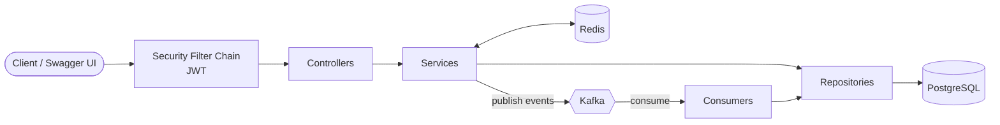

# intelliCar

> An AI-assisted used car marketplace backend built with Spring Boot, PostgreSQL, Redis and Apache Kafka.


intelliCar is the backend of a car gallery platform where sellers publish vehicle listings and buyers browse, filter and make price offers. Domain events (new offers, listing views, status changes) are processed asynchronously through Kafka, and frequently read data is cached in Redis. An AI assistant built with Spring AI is planned as the next milestone (see [Roadmap](#roadmap)).

This project was developed as a graduation project.

---

## Table of Contents

- [Features](#features)
- [Tech Stack](#tech-stack)
- [Architecture](#architecture)
- [Event-Driven Design with Kafka](#event-driven-design-with-kafka)
- [Domain Model](#domain-model)
- [API Overview](#api-overview)
- [Getting Started](#getting-started)
- [Configuration](#configuration)
- [Project Structure](#project-structure)
- [Design Decisions](#design-decisions)
- [Roadmap](#roadmap)

---

## Features

**Implemented**

- **Authentication and authorization:** registration, login, JWT access tokens, rotating refresh tokens, logout, role-based users (`BUYER`, `SELLER`, `ADMIN`).
- **Listings:** create, update and soft-delete car listings with multiple images and a primary image.
- **Search and filtering:** dynamic, paginated filtering by brand, model, city, price range, year range, fuel type and transmission.
- **Offers:** buyers make offers on active listings, sellers accept or reject them. Business rules prevent offers on your own car or on inactive listings, and duplicate pending offers.
- **Asynchronous processing with Kafka:** seller and buyer notifications, listing view counting, and automatic expiry of pending offers when a car is sold or deactivated.
- **Caching:** car detail responses are cached in Redis and evicted on update or delete.
- **API documentation:** interactive Swagger UI generated from the code.
- **Containerized setup:** PostgreSQL, Redis, Kafka and the backend start with a single Docker Compose command.

**Planned**

- AI assistant that ranks the best cars for a given budget.
- AI-based fair price estimation for a seller's existing car, based on similar listings.

---

## Tech Stack

| Area | Technology | Purpose |
|---|---|---|
| Language | Java 21 | Main language |
| Framework | Spring Boot 4.1.1 | Application framework and auto-configuration |
| Web | Spring Web MVC | REST controllers |
| Persistence | Spring Data JPA, Hibernate | ORM, repositories, `Specification`-based dynamic queries |
| Database | PostgreSQL 15 | Primary relational data store |
| Cache | Redis 7, Spring Cache | Caching of listing details |
| Messaging | Apache Kafka (KRaft mode), Spring for Apache Kafka | Asynchronous, event-driven processing |
| Security | Spring Security, JJWT 0.12.5, BCrypt | Stateless JWT authentication, password hashing |
| Validation | Jakarta Bean Validation | Request validation |
| Mapping | MapStruct 1.5.5 | Entity to DTO mapping |
| Boilerplate | Lombok | Getters, constructors, logging |
| API docs | springdoc-openapi 3.1.1 | OpenAPI 3 spec and Swagger UI |
| Build | Maven (wrapper included) | Build and dependency management |
| Containers | Docker, Docker Compose | Local environment and deployment image |

---

## Architecture

The application follows a classic layered architecture. Controllers only handle HTTP concerns, services contain business rules and transactions, repositories talk to the database. Request and response objects are immutable Java records.



---

## Event-Driven Design with Kafka

Slow or secondary work is moved out of the request path and handled asynchronously.

| Topic | Published by | Consumer (group) | What it does |
|---|---|---|---|
| `offer-events` | Offer service when an offer is created or answered | `OfferNotificationConsumer` (`notification-group`) | Notifies the seller of a new offer and the buyer of the decision. Currently logs the notification; plug in e-mail, SMS or push here. |
| `car-view-events` | Car controller on every listing view | `CarViewConsumer` (`view-counter-group`) | Increments the view counter with an atomic SQL update. |
| `car-status-events` | Car service when the status changes or a listing is deleted | `CarStatusConsumer` (`offer-expiry-group`) | Sets all `PENDING` offers of a car to `EXPIRED` when it becomes `SOLD` or `INACTIVE`. |

Key points:

- **Publish after commit.** Events are sent only after the database transaction commits, so a rolled-back request never produces a phantom event.
- **Resilient producer.** If Kafka is unreachable, the request still succeeds and the failure is logged (`max.block.ms` is limited to 3 seconds).
- **Ordering per entity.** The entity id is used as the message key, so all events of one offer or car land in the same partition and stay ordered.
- **View counting outside the cache.** The detail endpoint is cached, so a cache hit never reaches the service method. The view event is therefore published from the controller, which runs on every request.
- **JSON events** are defined as Java records in the `event` package.

---

## Domain Model

| Entity | Description | Key fields |
|---|---|---|
| `User` | Registered account, implements Spring Security `UserDetails` | email, passwordHash, firstName, lastName, phone, role |
| `Car` | A vehicle listing | brand, model, year, mileage, price, fuelType, transmission, city, description, viewCount, status, seller |
| `CarImage` | Image of a listing | imageUrl, isPrimary, car |
| `Offer` | A buyer's price offer for a car | offeredPrice, note, status, car, buyer |
| `RefreshToken` | Server-side refresh token, one per user | token, expiryDate, revoked, user |

Enumerations:

- `UserRole`: `BUYER`, `SELLER`, `ADMIN`
- `CarStatus`: `ACTIVE`, `PENDING_REVIEW`, `SOLD`, `INACTIVE`
- `OfferStatus`: `PENDING`, `ACCEPTED`, `REJECTED`, `EXPIRED`
- `FuelType`: `GASOLINE`, `DIESEL`, `HYBRID`, `ELECTRIC`
- `Transmission`: `MANUAL`, `AUTOMATIC`

---

## API Overview

Base path: `/intelliCar/api/v1`. Full interactive documentation is available in Swagger UI once the app is running.

Protected endpoints require the header `Authorization: Bearer <access_token>`.

### Auth

| Method | Path | Auth | Description |
|---|---|---|---|
| POST | `/auth/register` | Public | Create an account and receive tokens |
| POST | `/auth/login` | Public | Log in and receive tokens |
| POST | `/auth/refresh-token` | Public | Exchange a refresh token for a new token pair |
| POST | `/auth/logout` | Required | Revoke the user's refresh token |

### Users

| Method | Path | Auth | Description |
|---|---|---|---|
| GET | `/users/me` | Required | Current user's profile |
| GET | `/users/{id}` | Required | Profile of a user |

### Cars

| Method | Path | Auth | Description |
|---|---|---|---|
| POST | `/car` | Required | Create a listing |
| GET | `/car` | Public | List active cars (filter and paginate) |
| GET | `/car/{id}` | Public | Listing details |
| GET | `/car/my-cars` | Required | Current user's listings |
| PUT | `/car/{id}` | Owner | Update price, mileage, description, status |
| DELETE | `/car/{id}` | Owner | Soft delete (status becomes `INACTIVE`) |

Filter parameters for `GET /car` (all optional): `brand`, `model`, `city`, `minPrice`, `maxPrice`, `minYear`, `maxYear`, `fuelType`, `transmission`, plus standard `page`, `size`, `sort`.

```
GET /intelliCar/api/v1/car?brand=bmw&city=ankara&maxPrice=1500000&fuelType=DIESEL&page=0&size=10&sort=price,asc
```

### Car images

| Method | Path | Auth | Description |
|---|---|---|---|
| POST | `/carImage/{carId}` | Owner | Add images to a listing |
| PATCH | `/carImage/{carId}/images/{imageId}/primary` | Owner | Set the primary image |
| DELETE | `/carImage/{imageId}` | Owner | Delete an image |

### Offers

| Method | Path | Auth | Description |
|---|---|---|---|
| POST | `/offer` | Required | Make an offer on an active car |
| PATCH | `/offer/{id}/respond?newStatus=ACCEPTED\|REJECTED` | Car owner | Accept or reject an offer |
| GET | `/offer/cars/{carId}` | Car owner | Offers received for a car |
| GET | `/offer/my-offers` | Required | Offers made by the current user |

---

## Getting Started

### Prerequisites

- JDK 21
- Docker and Docker Compose
- (Optional) Maven, the included `./mvnw` wrapper is enough

### 1. Clone the repository

```bash
git clone https://github.com/<your-username>/intelliCar.git
cd intelliCar
```

### 2. Create your environment file

```bash
cp .env.example .env
```

Open `.env` and set your own values (see [Configuration](#configuration)). Generate a strong JWT secret with:

```bash
openssl rand -hex 32
```

### 3. Run

**Option A: everything in Docker**

```bash
docker compose up -d --build
```

**Option B: infrastructure in Docker, application from your IDE or terminal**

```bash
docker compose up -d postgres redis kafka
./mvnw spring-boot:run
```

The application must be started from the project root so that it can read the `.env` file.

### 4. Open the API docs

- Swagger UI: <http://localhost:8080/swagger-ui.html>
- OpenAPI JSON: <http://localhost:8080/v3/api-docs>

In Swagger UI, call `/auth/register` or `/auth/login`, copy the `accessToken`, click **Authorize** and paste it to call protected endpoints.

### Useful commands

```bash
# Stop everything
docker compose down

# Stop and delete all data (database, Redis, Kafka)
docker compose down -v

# Watch Kafka messages
docker exec -it intellicar-kafka /opt/kafka/bin/kafka-console-consumer.sh \
  --bootstrap-server localhost:9092 --topic offer-events --from-beginning

# Run tests (requires PostgreSQL, Redis and Kafka to be running)
./mvnw test
```

---

## Configuration

Secrets are never stored in the repository. They are read from a local `.env` file (ignored by git). A template is provided in `.env.example`.

| Variable | Description | Example |
|---|---|---|
| `POSTGRES_DB` | Database name | `intellicar_db` |
| `POSTGRES_USER` | Database user | `postgres` |
| `POSTGRES_PASSWORD` | Database password | use a strong value |
| `JWT_SECRET` | HMAC signing key for JWTs, at least 32 characters | output of `openssl rand -hex 32` |

Other settings live in `src/main/resources/application.properties`:

| Property | Default | Description |
|---|---|---|
| `intellicar.security.jwt.access-expiration` | `900000` (15 min) | Access token lifetime in ms |
| `intellicar.security.jwt.refresh-expiration` | `604800000` (7 days) | Refresh token lifetime in ms |
| `spring.kafka.bootstrap-servers` | `localhost:9092` | Kafka address (`kafka:29092` inside Docker) |
| `spring.data.redis.host` / `port` | `localhost` / `6379` | Redis address |

When the backend runs inside Docker Compose, connection settings are overridden through environment variables in `docker-compose.yaml`.

---

## Project Structure

```
intelliCar
├── src/main
│   ├── java/com/efeerturk/intelliCar
│   │   ├── config/        Security, Redis, Kafka, Swagger and application beans
│   │   ├── controller/    REST controllers
│   │   ├── dto/           Request and response records
│   │   ├── enums/         Domain enumerations and error message types
│   │   ├── event/         Kafka event records
│   │   ├── exception/     Custom exception and error models
│   │   ├── handler/       Global exception handler
│   │   ├── jwt/           JWT service, authentication filter, entry point
│   │   ├── kafka/         Event publisher, topic names
│   │   │   └── consumer/  Kafka listeners
│   │   ├── mapper/        MapStruct mappers
│   │   ├── model/         JPA entities
│   │   ├── repository/    Spring Data repositories and JPA specifications
│   │   └── service/       Service interfaces and implementations (impl/)
│   └── resources
│       └── application.properties
├── src/test               Tests
├── Dockerfile             Multi-stage build (Maven, then a slim JRE image)
├── docker-compose.yaml    PostgreSQL, Redis, Kafka and backend
├── .env.example           Environment variable template
└── pom.xml
```

---

## Design Decisions

- **Stateless authentication.** Short-lived JWT access tokens plus a refresh token stored in the database. A refresh token is replaced on every refresh and deleted on logout, so it can be revoked server-side.
- **Records for DTOs and events.** Immutable, concise and easy to serialize.
- **Soft delete.** Deleting a listing sets its status to `INACTIVE` instead of removing rows, which keeps offer history intact.
- **Specification-based filtering.** Filters are optional and combined dynamically into a single query. Only `ACTIVE` listings appear in search results.
- **Ownership checks in the service layer.** Only the seller of a car can update it, manage its images, or answer its offers.
- **Docker image.** Multi-stage build, runs as a non-root user and respects container memory limits.

---

## Roadmap

- [ ] AI budget assistant: rank the best cars for a user's budget (Spring AI)
- [ ] AI price estimation: suggest an average price from similar listings (Spring AI)
- [ ] Replace the notification log with real e-mail or push delivery
- [ ] Integration tests with Testcontainers (PostgreSQL, Redis, Kafka)
- [ ] CI pipeline with GitHub Actions
- [ ] Admin moderation flow for `PENDING_REVIEW` listings

---

## Author

Developed by **Efe Erturk** as a graduation project.
